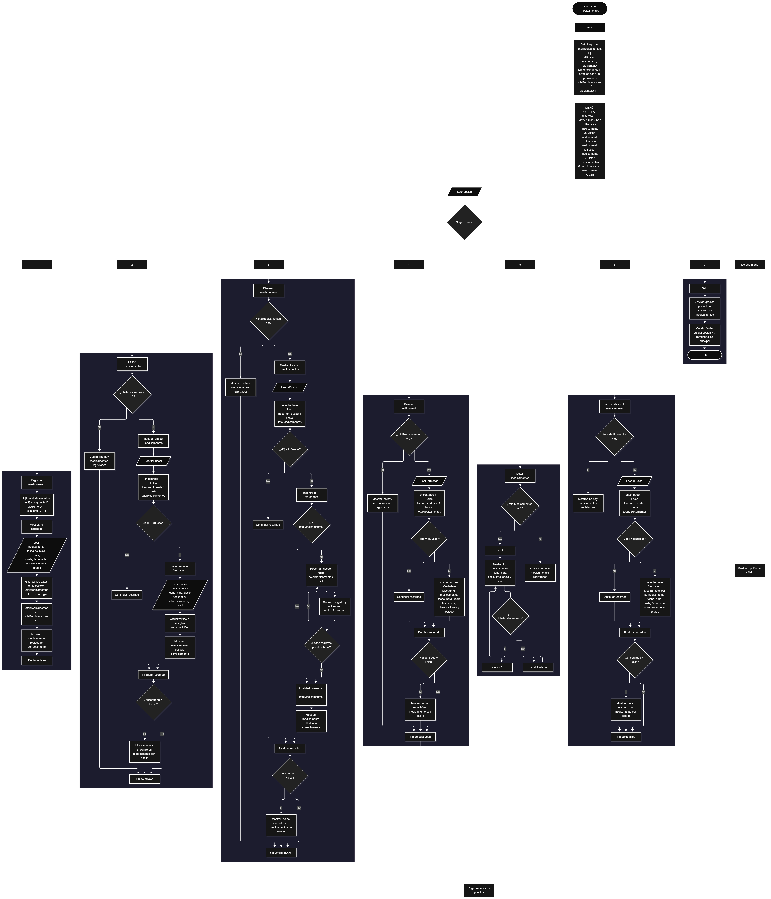

Este proyecto, llamado <b>alarma de medicamentos</b>, fue desarrollado en <b>pseint</b> como un ejercicio práctico para fortalecer la lógica de programación mediante la creación de un sistema de gestión de medicamentos desde la consola. El programa cuenta con un menú principal de siete opciones que permite <b>registrar, editar, eliminar, buscar, listar y consultar los detalles</b> de los medicamentos programados. Cada medicamento almacena datos como el nombre, la fecha de inicio, la hora, la dosis, la frecuencia, las observaciones y el estado, utilizando arreglos con una capacidad de <b>100 posiciones durante la ejecución</b>. Además, cada medicamento recibe un <b>id único y autoincremental</b> que se utiliza para identificarlo en las operaciones de edición, eliminación, búsqueda y consulta. Durante su desarrollo se aplicaron conceptos fundamentales de programación, como variables, arreglos, estructuras condicionales, ciclos repetitivos y estructuras de selección, además de procesos para buscar, modificar, eliminar y organizar registros. Este proyecto permite poner en práctica los conocimientos adquiridos en PSeInt y sirve como base para desarrollar sistemas de gestión más avanzados utilizando otros lenguajes y tecnologías.

<h2 align="center">⚙️ Funcionamiento del menú principal</h2>

### ➕ Registrar medicamento

La opción <b>1) registrar medicamento</b> permite agregar un nuevo medicamento a la alarma. El programa asigna automáticamente un <b>id</b> tomado de la variable <b>siguienteID</b>, lo muestra en pantalla y luego incrementa esa variable en uno, de modo que cada medicamento tenga un identificador distinto. Después solicita el <b>nombre del medicamento, la fecha de inicio, la hora, la dosis, la frecuencia, las observaciones y el estado</b>, y guarda cada dato en la posición <b>totalMedicamentos + 1</b> de su respectivo arreglo. Al terminar, aumenta la variable <b>totalMedicamentos</b> en uno y muestra el mensaje <b>"medicamento registrado correctamente."</b>.

### ✏️ Editar medicamento

La opción <b>2) editar medicamento</b> permite modificar la información de un medicamento registrado. Primero, el programa comprueba si existen medicamentos almacenados mediante la variable <b>totalMedicamentos</b>. Si no hay registros, muestra el mensaje <b>"no hay medicamentos registrados."</b>. En caso contrario, presenta una lista con el id, medicamento, fecha, hora, dosis, frecuencia, observaciones y estado de cada registro. Después, solicita el <b>id</b> del medicamento que se desea editar y utiliza un ciclo <b>para</b> que recorre los arreglos comparando <b>id[i] = idBuscar</b>. Cuando encuentra la coincidencia, cambia la variable <b>encontrado</b> a <b>verdadero</b>, solicita los nuevos valores de los siete campos y los guarda directamente en las posiciones correspondientes. Finalmente, presenta el mensaje <b>"medicamento editado correctamente."</b>. Si al terminar el recorrido <b>encontrado</b> sigue en <b>falso</b>, informa <b>"no se encontró un medicamento con ese id."</b>.

### 🗑️ Eliminar medicamento

La opción <b>3) eliminar medicamento</b> permite eliminar un medicamento registrado mediante su id. Antes de comenzar, el programa comprueba que existan medicamentos almacenados. Si la lista está vacía, muestra el mensaje <b>"no hay medicamentos registrados."</b>. Si hay registros, presenta la lista completa y solicita el <b>id</b> del medicamento que se desea eliminar. Al encontrarlo, y siempre que no sea el último de la lista, utiliza un ciclo <b>para</b> controlado por la variable <b>j</b>, que desplaza una posición hacia atrás los datos de los medicamentos posteriores en los ocho arreglos: <b>id, medicamento, fecha, hora, dosis, frecuencia, observaciones y estado</b>. Posteriormente, disminuye la variable <b>totalMedicamentos</b> en uno y muestra el mensaje <b>"medicamento eliminado correctamente."</b>. Si el id no corresponde a ningún medicamento, informa que no se encontró un medicamento con ese id.

### 🔎 Buscar medicamento

La opción <b>4) buscar medicamento</b> permite localizar un medicamento mediante su id. Primero, el programa comprueba si existen medicamentos registrados. Si la lista está vacía, muestra el mensaje <b>"no hay medicamentos registrados."</b>. En caso contrario, solicita el id, inicializa la variable lógica <b>encontrado</b> con el valor <b>falso</b> y utiliza un ciclo <b>para</b> para recorrer el arreglo <b>id</b> comparándolo con el valor introducido mediante la condición <b>id[i] = idBuscar</b>. Cuando encuentra una coincidencia, cambia <b>encontrado</b> a <b>verdadero</b> y muestra todos los datos del medicamento en una sola línea separados por barras. Si finaliza el recorrido sin coincidencias, presenta el mensaje <b>"no se encontró un medicamento con ese id."</b>.

### 📋 Listar medicamentos

La opción <b>5) listar medicamentos</b> permite visualizar los medicamentos registrados actualmente. Antes de mostrar la información, el programa comprueba si la variable <b>totalMedicamentos</b> es igual a cero. Si no existen registros, presenta el mensaje <b>"no hay medicamentos registrados."</b>. Si hay medicamentos disponibles, utiliza un ciclo <b>para</b> que recorre los arreglos desde la primera posición hasta el total de medicamentos registrados, mostrando en cada línea el id, el medicamento, la fecha, la hora, la dosis, la frecuencia y el estado. En esta vista no se muestran las <b>observaciones</b>, que se consultan con las opciones de buscar o ver detalles. Esta función facilita revisar los registros existentes sin necesidad de buscar cada medicamento individualmente.

### 📄 Ver detalles del medicamento

La opción <b>6) ver detalles del medicamento</b> permite consultar todos los datos de un medicamento específico. Primero, el programa comprueba si existen medicamentos registrados. Si la lista está vacía, muestra el mensaje <b>"no hay medicamentos registrados."</b>. En caso contrario, solicita el id del medicamento y lo busca con un ciclo <b>para</b>. Si lo encuentra, muestra cada dato en una línea independiente: <b>id, medicamento, fecha, hora, dosis, frecuencia, observaciones y estado</b>. Si el id no corresponde a ningún medicamento, presenta el mensaje <b>"no se encontró un medicamento con ese id."</b>.

### 🚪 Salir del menú principal

La opción <b>7) salir</b> finaliza la ejecución del programa y muestra el mensaje <b>"gracias por utilizar la alarma de medicamentos."</b>. El menú principal se encuentra dentro de una estructura repetitiva <b>repetir ... hasta que</b>, cuya condición de salida es <b>opcion = 7</b>, que coincide con el número de la opción de salida presentada en el menú. Mientras el usuario seleccione cualquier otra opción, el programa vuelve a mostrar el menú.

<h2 align="center">🧠 Temas aplicados en el proyecto</h2>

### 📦 Variables

En este proyecto se utilizan variables para guardar la opción seleccionada en el menú, controlar la cantidad de medicamentos registrados, generar los identificadores, recorrer los arreglos, almacenar el id que se desea buscar y comprobar si se encontró una coincidencia. Cada variable cumple una función específica dentro de las operaciones de gestión de medicamentos.

🔢 **Opcion:** Almacena la opción seleccionada por el usuario en el menú principal.

📊 **TotalMedicamentos:** Almacena la cantidad actual de medicamentos registrados.

🆔 **SiguienteID:** Guarda el próximo id que se asignará a un medicamento nuevo. Solo aumenta, por lo que los ids no se repiten aunque se eliminen registros.

🔄 **I:** Funciona como contador en los ciclos <b>para</b> que recorren los arreglos.

🔁 **J:** Controla el recorrido utilizado para desplazar los datos durante la eliminación de un medicamento.

🔎 **IdBuscar:** Almacena el id introducido por el usuario para editar, eliminar, buscar o consultar un medicamento.

✅ **Encontrado:** Variable lógica que indica si se encontró un medicamento con el id solicitado.

### 🗃️ Arreglos

En este proyecto se utilizan ocho arreglos relacionados con los datos de cada medicamento. Cada arreglo tiene una capacidad de <b>100 posiciones</b> y utiliza el mismo índice para representar la información correspondiente a un mismo medicamento. Por ejemplo, los datos de un medicamento almacenado en la posición <b>1</b> se encuentran distribuidos entre <b>id[1], medicamento[1], fecha[1], hora[1], dosis[1], frecuencia[1], observaciones[1] y estado[1]</b>. Esta organización permite recorrer, buscar, modificar, mostrar y eliminar los medicamentos de manera ordenada.

🆔 **Id[100]:** Almacena el identificador único de cada medicamento.

💊 **Medicamento[100]:** Almacena el nombre del medicamento.

📅 **Fecha[100]:** Almacena la fecha de inicio del tratamiento.

⏰ **Hora[100]:** Almacena la hora de la toma.

💧 **Dosis[100]:** Almacena la cantidad que se debe tomar.

🔁 **Frecuencia[100]:** Almacena cada cuánto se debe tomar el medicamento.

📝 **Observaciones[100]:** Almacena notas adicionales sobre el medicamento.

📌 **Estado[100]:** Almacena el estado del medicamento.

### 🔀 Estructuras condicionales

En este proyecto se utilizan las estructuras <b>si</b> y <b>sino</b> para verificar si existen registros antes de editar, eliminar, buscar, listar o consultar, para determinar si el id introducido corresponde a un medicamento existente y para decidir si es necesario desplazar los datos al eliminar (cuando el medicamento no es el último de la lista). Estas condiciones permiten que el programa responda de manera diferente según el estado de la lista y el resultado de cada operación.

### 🔄 Estructuras repetitivas

En este proyecto se utilizan los ciclos <b>para</b> y <b>repetir ... hasta que</b>. Los ciclos <b>para</b> permiten recorrer los arreglos para mostrar los medicamentos, buscar ids y acceder a los registros seleccionados. Durante la eliminación, también se utilizan para desplazar los datos de los medicamentos posteriores una posición hacia atrás. Por otro lado, el ciclo <b>repetir ... hasta que</b> mantiene activo el menú principal para que el usuario pueda ejecutar diferentes operaciones antes de salir del programa.

### 🎯 Estructura según

El programa evalúa el valor almacenado en la variable <b>opcion</b> y ejecuta el bloque de instrucciones correspondiente. Cada caso representa una operación específica del sistema: <b>registrar, editar, eliminar, buscar, listar, ver detalles o salir</b>. También se utiliza el bloque <b>de otro modo</b> para mostrar el mensaje <b>"opción no válida."</b> cuando el valor introducido no coincide con ninguna de las opciones definidas.

### 🔢 Dimensionamiento de arreglos

El programa utiliza la instrucción <b>dimension</b> para establecer la capacidad de los arreglos que almacenan la información de los medicamentos. Se definieron <b>100 posiciones</b> para cada arreglo. La cantidad de posiciones ocupadas se controla mediante la variable <b>totalMedicamentos</b>, por lo que las operaciones recorren únicamente los registros comprendidos entre la primera posición y el total actual de medicamentos.

### 🔄 Reorganización de registros

Cuando se selecciona un medicamento para eliminarlo, el programa utiliza un ciclo <b>para</b> que comienza en la posición del medicamento y llega hasta <b>totalMedicamentos - 1</b>. En cada repetición, los datos de la posición siguiente se copian sobre la posición actual en los ocho arreglos. Después, la variable <b>totalMedicamentos</b> disminuye en uno. De esta manera, los medicamentos posteriores ocupan las posiciones disponibles sin dejar espacios vacíos entre los registros activos.

<h2 align="center">¿Cómo se implementaron las operaciones crud en el proyecto?</h2>

Las operaciones <b>crud</b> se implementaron mediante las opciones del menú principal, permitiendo administrar los medicamentos registrados. La operación <b>crear</b> corresponde a <b>registrar medicamento</b>, donde se introducen los datos de un nuevo medicamento; <b>leer</b> se realiza mediante las opciones <b>buscar medicamento, listar medicamentos y ver detalles del medicamento</b>; <b>actualizar</b> corresponde a <b>editar medicamento</b>, donde se modifican los datos de un medicamento registrado; y <b>eliminar</b> se realiza mediante la opción <b>eliminar medicamento</b>. Estas operaciones utilizan variables, arreglos, condicionales y ciclos para gestionar la información almacenada temporalmente durante la ejecución del programa.

<h2 align="center">Diagrama de flujo del proyecto</h2>

<h2 align="center">🛡️ Validaciones del programa</h2>

### 📭 No existen medicamentos registrados

Esta validación se utiliza en las opciones de <b>editar, eliminar, buscar, listar y ver detalles</b>. El programa comprueba si la variable <b>totalMedicamentos</b> es igual a <b>0</b> y, si no existen medicamentos registrados, muestra el mensaje <b>"no hay medicamentos registrados."</b>. Esta comprobación evita continuar con las operaciones que necesitan información almacenada cuando la lista está vacía.

### ❌ Medicamento no encontrado

Esta validación se utiliza en las opciones de <b>editar, eliminar, buscar y ver detalles</b>. El programa inicializa la variable lógica <b>encontrado</b> con el valor <b>falso</b> y recorre el arreglo <b>id</b> para comparar cada valor con el id introducido por el usuario. Cuando encuentra una coincidencia, cambia la variable a <b>verdadero</b> y ejecuta la operación. Si al finalizar el recorrido <b>encontrado</b> continúa siendo <b>falso</b>, muestra el mensaje <b>"no se encontró un medicamento con ese id."</b>.

### 🆔 Identificadores únicos

El programa asigna a cada medicamento un id mediante la variable <b>siguienteID</b>, que aumenta en uno con cada registro y nunca disminuye. Gracias a esto, dos medicamentos nunca comparten el mismo id, incluso si se eliminan registros intermedios, lo que permite que las búsquedas por id siempre identifiquen un único medicamento.

### ⚠️ Opción inválida

La estructura <b>segun</b> incluye el bloque <b>de otro modo</b>, que muestra el mensaje <b>"opción no válida."</b> cuando el usuario introduce un número que no corresponde a ninguna de las opciones definidas en el menú.

<h2 align="center">🚧 Limitaciones y mejoras futuras</h2>

Como proyecto de práctica, la versión actual tiene limitaciones conocidas que se pueden mejorar en futuras versiones:

- **Capacidad máxima:** los arreglos tienen 100 posiciones, pero la opción de registrar no comprueba si ya se alcanzó ese límite. Se puede agregar la validación <b>totalMedicamentos &lt; 100</b>.
- **Listado incompleto:** la opción de listar no muestra las observaciones. Se puede agregar ese campo para que todas las vistas coincidan.
- **Tipos de datos:** los arreglos se dimensionan sin declarar explícitamente su tipo. Se pueden definir con <b>Definir ... Como Cadena</b>.
- **Entradas libres:** la fecha, la hora, la dosis, la frecuencia y el estado se leen como texto libre, sin validar su formato. Se podrían ofrecer opciones predefinidas, por ejemplo para el estado (pendiente o tomado).
- **Validación del menú:** el programa no controla que el usuario escriba un valor que no sea numérico en el menú principal.
- **Alarma real:** el programa registra y organiza los medicamentos, pero aún no avisa ni calcula la siguiente toma a partir de la frecuencia. Una mejora natural sería una opción para ver los medicamentos pendientes o marcar una toma como realizada.
- **Código repetido:** la línea que muestra un medicamento y la búsqueda por id se repiten en varias opciones; se podrían reemplazar por <b>subprocesos</b>.

<h2 align="center">🎯 Objetivo del proyecto</h2>

El objetivo principal de este proyecto es fortalecer la <b>lógica de programación</b> mediante el desarrollo de un sistema de gestión de medicamentos en <b>pseint</b>. A través de su construcción se busca aplicar los conocimientos adquiridos sobre variables, arreglos, estructuras condicionales, ciclos repetitivos y estructuras de selección, integrándolos para resolver un problema de manera organizada. Además, el proyecto permite comprender cómo registrar, consultar, modificar y eliminar información en una aplicación de consola, estableciendo una base para desarrollar sistemas de gestión más completos con otros lenguajes y tecnologías.

